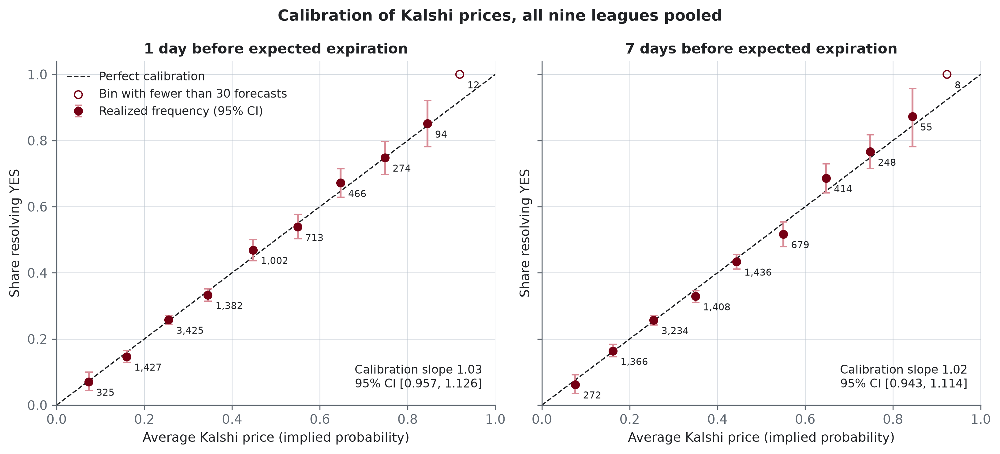
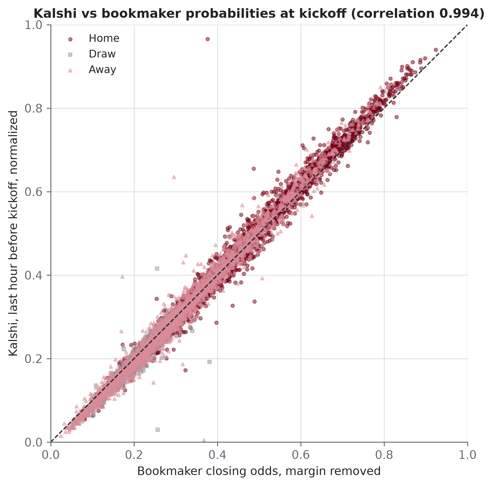
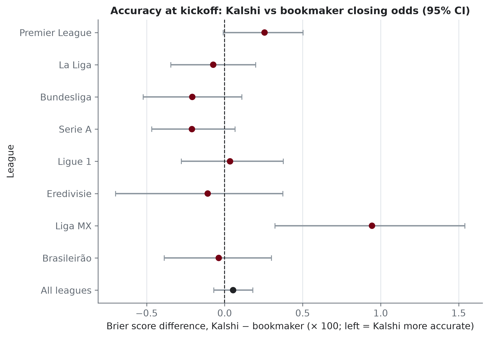
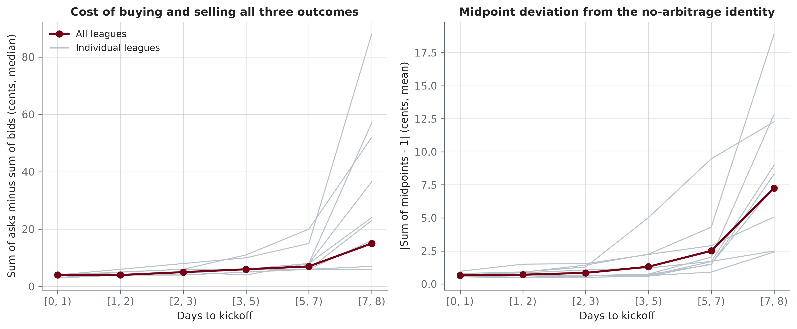

# Kalshi vs Bookmakers

**Are prediction-market prices probabilities?** We test Kalshi's football (soccer) match-winner markets across nine competitions — 3,683 matches and more than half a million hours of quotes — and benchmark them against bookmaker odds on the same matches.


📄 **Full report:** [15_456_project1_Hunter_Nader.pdf](15_456_project1_Hunter_Nader.pdf)

---

## TL;DR

| Question | Answer |
|---|---|
| Do Kalshi prices work as probabilities? | **Yes.** Pooled calibration slope 1.03 (95% CI 0.96–1.13); no favourite–longshot bias. |
| Are they as good as bookmakers? | **Yes.** Brier score 0.5834 vs 0.5829 on 3,318 matched matches; correlation 0.994. Liga MX is the one exception. |
| Is there free money (arbitrage)? | **No.** 3,931 apparent arbitrage hours (0.75%) before fees; 2 after Kalshi's fees, and neither is credible. |
| Can simple betting rules win? | **No.** 27 naive rules lose 7.55% on average — roughly half a spread plus a fee. Betting on Kalshi–bookmaker disagreements fails out of sample. |
| Where does it break down? | In thin, immature markets: a week before kickoff, and in the Eredivisie and Liga MX, where prices look too extreme. |

**Bottom line:** the midpoint of a liquid Kalshi football market is a calibrated probability of bookmaker quality. What separates a bettor from that probability is the cost of trading, not mispricing.

---

## Results

### Prices are calibrated
Outcomes priced at about 30% happen about 30% of the time, at every price level and at both horizons.



### Kalshi and bookmakers are essentially the same forecast





### Deviations follow trading costs
Buying and selling all three outcomes costs about 4 cents in the last day before kickoff and about 15 cents a week out; the sum of midpoints drifts further from $1 as spreads widen.



---

## Data

| Source | What | Period |
|---|---|---|
| [Kalshi Trade API](https://docs.kalshi.com) | Contract metadata and hourly bid/ask candlesticks for every finalized match-winner contract | Apr 2025 – Nov 2026 |
| [Football-Data.co.uk](https://www.football-data.co.uk) | Results and bookmaker odds (closing and pre-closing) | Same seasons |

**Competitions:** Premier League, La Liga, Bundesliga, Serie A, Ligue 1, Eredivisie, Liga MX, Brasileirão, UEFA Champions League (no bookmaker benchmark for the Champions League).

> The raw Kalshi data (~1.7M hourly candles) is too large for GitHub and is not included. Run `src/data_collection.ipynb` to download it from Kalshi's public API (no account needed). The Football-Data.co.uk CSVs are included in `data/bookmakers/`.

---

## Repository structure

```
├── 15_456_project1_Hunter_Nader.pdf   # Full report
├── src/
│   ├── data_collection.ipynb          # Download Kalshi markets + hourly candlesticks
│   ├── full_league_analysis.ipynb     # Per-competition analysis
│   ├── run_all_leagues.ipynb          # Runs the per-competition analysis for all nine leagues
│   ├── cross_league_analysis.ipynb    # Pooled calibration, heterogeneity, drivers, trading rules
│   ├── arbitrage_auditing.ipynb       # Hourly no-arbitrage screen and candidate checks
│   └── bookmaker_benchmark.ipynb      # Kalshi vs bookmakers: accuracy, cost, betting backtests
├── data/
│   └── bookmakers/                    # Football-Data.co.uk odds files
├── results/                           # CSV outputs and executed notebooks
└── images/                            # All figures (PNG + PDF)
```

---

## Reproduce

```bash
git clone https://github.com/ralphndr/Kalshi-vs-bookmakers.git
cd Kalshi-vs-bookmakers
pip install pandas numpy scipy matplotlib jupyter
```

Then run the notebooks in `src/` in the order listed above. Every number and figure in the report is reproduced by the notebooks.

---

## Methods at a glance

- **Calibration:** reliability diagrams, logistic calibration regression (slope = 1 is perfect), outcome gaps, Cochran's Q for heterogeneity
- **Accuracy:** three-outcome Brier score, skill vs a no-look-ahead base-rate benchmark
- **No-arbitrage:** YES/NO bundle bounds with executable quotes, Kalshi's taker fee and discounting, checked at every complete hour
- **Inference:** match-level cluster bootstrap (1,000 draws), clustered standard errors, Holm multiple-testing correction
- **Trading:** 27 mechanical rules and two Kalshi–bookmaker disagreement strategies, tuned on the first 70% of matches and tested on the last 30%

---

## Authors

**Cameron Hunter** and **Ralph Nader** — MIT Sloan School of Management, 15.456 Financial Engineering, Fall 2026
